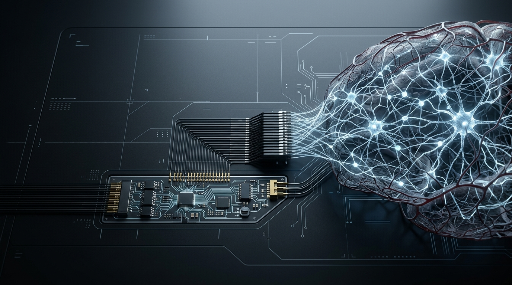

<div align="center">

  

  <br/><br/>

  # Dmitry Alexandrovski
  ### Co-founder & CTO @ [CortexNeo](https://cortexneo.digital/) &nbsp;•&nbsp; Neurotech & Applied AI Systems Engineer

  <p align="center">
    <em>Engineering the computational frontier between biophysical neural dynamics and deterministic machine intelligence.</em>
  </p>

  <p align="center">
    <code>SYSTEM STATUS: ACTIVE R&D</code> &nbsp;•&nbsp;
    <code>FOCUS: 3D VOLUMETRIC CT / BIO-COMPUTE</code> &nbsp;•&nbsp;
    <code>ZERO-HALLUCINATION PROTOCOL</code>
  </p>

  <p align="center">
    <a href="https://cortexneo.digital/"></a>
    <a href="https://t.me/dmitryalexandrovski"></a>
  </p>

</div>

---

### 📡 01 // DIRECTIVE & EXECUTIVE PROFILE

I operate at the intersection of **deep neural architectures, biophysical signal processing, and high-stakes medical compute**. My work focuses on replacing empirical clinical guesswork with deterministic, high-bandwidth artificial intelligence.

Currently serving as **Co-founder & CTO at [CortexNeo](https://cortexneo.digital/)**, orchestrating end-to-end engineering of our deep-learning clinical decision intelligence engine for hyper-acute ischemic stroke intervention. When cerebral tissue undergoes ischemia, every 60 seconds of delay destroys 1.9 million neurons. We build autonomous volumetric inference systems engineered to shave critical minutes off triage and predict catastrophic post-intervention hemorrhage risks before the first scalpel or catheter moves.

```
[ CLINICAL CHALLENGE ] ──> Acute Ischemia & Microvascular Permeability
[ HARDWARE & SENSORS ] ──> Multi-Slice Helical Non-Contrast CT / Perfusion DICOM
[ COMPUTE PIPELINE   ] ──> Sub-second 3D Volumetric Tensor Inference & Risk Stratification
[ CLINICAL OUTCOME   ] ──> Deterministic, Explainable Action Guidance Under Pressure
```

---

### 🧬 02 // RESEARCH & ENGINEERING TAXONOMY

#### `[01]` Volumetric Computer Vision & Neural Biomarkers
* **High-Dimensional Spatial Tensors**: Processing raw isotropic/anisotropic 3D DICOM & NIfTI volumes with sub-millimeter precision.
* **Tissue Characterization**: Dense feature extraction for ischemic core localization, collateral flow grading, and micro-hemorrhagic transformation forecasting.
* **Explainable AI (XAI)**: High-resolution gradient-weighted class activation mapping (Grad-CAM), 3D volumetric attribution tensors, and counterfactual clinical explanations doctors can audit in real time.

#### `[02]` High-Performance Deep Learning Systems
* **Deterministic Inference Engines**: Optimized execution graphs with ONNX Runtime, TensorRT quantization (FP16/INT8), and custom CUDA kernels for minimal latency overhead.
* **Architectures**: Hybrid 3D Convolutional-Transformer backbones (Swin UNETR, 3D Attention U-Nets) calibrated for ultra-low signal-to-noise biomedical datasets.
* **Statistical Rigor**: Bayesian uncertainty estimation and calibration curves to prevent overconfident boundary predictions in life-or-death scenarios.

#### `[03]` Resilient Infrastructure & Distributed Backends
* **Distributed Services**: Fault-tolerant microservices written in high-efficiency Python (FastAPI/AsyncIO) and TypeScript, built for air-gapped hospital networks and cloud orchestration.
* **Data Pipelines**: High-throughput distributed storage, PACS/VNA DICOM router integrations, Redis cache clusters, and ACID-compliant state engines (PostgreSQL).
* **Enterprise Reliability**: Zero-downtime containerized architectures (Docker, Kubernetes) adhering to strict medical compliance and data anonymization standards.

---

### ⚡ 03 // ARCHITECTURE BLUEPRINT: CORTEXNEO

```
                                  CORTEXNEO INFERENCE PIPELINE
    ┌─────────────────────────┐               ┌─────────────────────────────────┐
    │  Raw DICOM / 3D CT Vol  │ ────────────> │ Spatial Resampling & Hounsfield │
    └─────────────────────────┘               │ Calibration Engine (Iso-voxel)  │
                                              └─────────────────────────────────┘
                                                               │
                                                               ▼
    ┌─────────────────────────┐               ┌─────────────────────────────────┐
    │ Patient Clinical Matrix │ ────────────> │ Multi-Modal Feature Fusion Core │
    │ (Vitals, Lab, Timeline) │               │   (Covariate + Volumetric)      │
    └─────────────────────────┘               └─────────────────────────────────┘
                                                               │
                                                               ▼
    ┌───────────────────────────────────────────────────────────────────────────┐
    │          Deep Volumetric Segmentation & Hemorrhage Risk Network           │
    │            • 3D Swin-Transformer Backbone                                 │
    │            • Spatial Cross-Attention Layers                               │
    │            • Uncertainty Quantification Head (Monte Carlo Dropout)        │
    └───────────────────────────────────────────────────────────────────────────┘
                                       │
                  ┌────────────────────┴────────────────────┐
                  ▼                                         ▼
    ┌───────────────────────────┐             ┌───────────────────────────┐
    │ 3D Risk Heatmap & XAI     │             │ Sub-Second API Response   │
    │ Attribution Vector        │             │ to Neuro-Interventionists │
    └───────────────────────────┘             └───────────────────────────┘
```

---

### 🛠️ 04 // CORE WEAPONRY & TECHNOLOGY MATRIX

<div align="center">

| Domain | Core Stack & Toolchain |
| :--- | :--- |
| **Deep Learning & Math** | `PyTorch` `TensorRT` `ONNX Runtime` `CUDA` `NumPy` `SciPy` `scikit-learn` `OpenCV` |
| **Medical Data & Neuro** | `DICOM (pydicom)` `NIfTI (nibabel)` `MONAI` `SimpleITK` `VTK` `3D Slicer` |
| **Systems & Architecture** | `Python (AsyncIO)` `FastAPI` `TypeScript` `Node.js` `Next.js` `C++` |
| **Data & Messaging** | `PostgreSQL` `Redis` `gRPC` `RESTful APIs` `Celery` |
| **Infrastructure & Ops** | `Docker` `Linux (Kernel tuning)` `Git` `CI/CD Pipelines` `NVIDIA GPU Cloud` |

</div>

<br/>

<div align="center">

  &nbsp;
  &nbsp;
  &nbsp;
  &nbsp;
  &nbsp;
  &nbsp;
  &nbsp;
  &nbsp;
  &nbsp;
  

</div>

---

### 📊 05 // TELEMETRY & SYSTEM VELOCITY

<div align="center">

  <a href="https://github.com/dmitryalexandrovski">
    
  </a>

</div>

---

### 🌐 06 // TRANSMISSION & COLLABORATION

I am always interested in discussing **biomedical foundation models, high-bandwidth neural interfaces, low-latency machine learning systems, and early-stage deep tech ventures**.

```yaml
Channel:
  Web:       https://cortexneo.digital
  Telegram:  @dmitryalexandrovski (https://t.me/dmitryalexandrovski)
  PGP / Bio: Available upon request
```

<div align="center">
  <br/>
  <sub><code>[ TERMINAL EOF ] // "TISSUE IS TIME. ACCELERATE COMPUTE, PRESERVE COGNITION."</code></sub>
</div>
